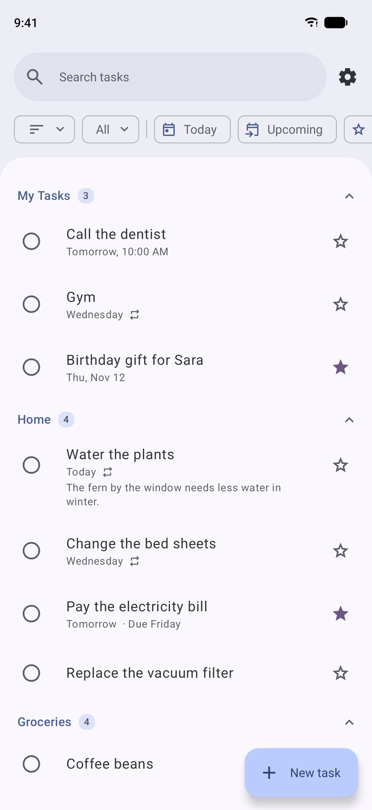
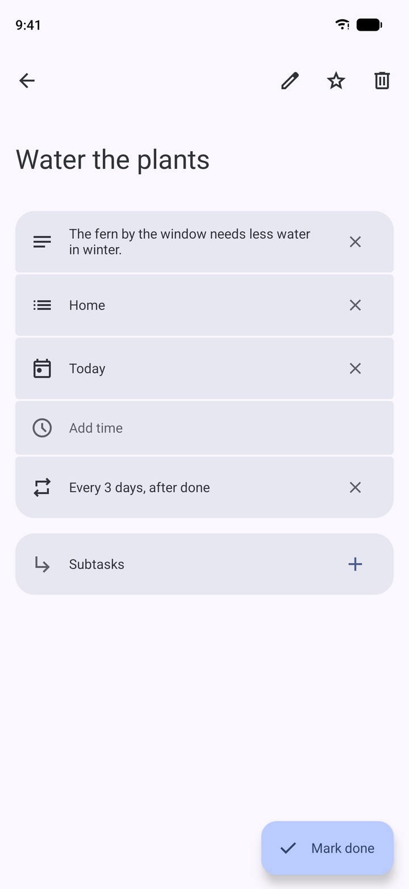
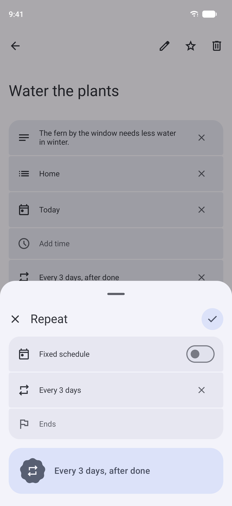
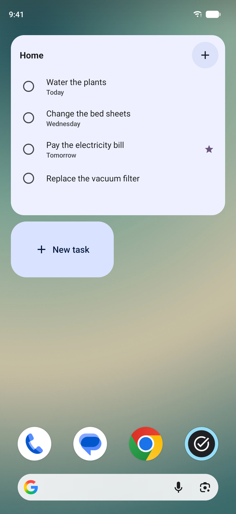

# Toda

An Android to-do app modelled on Google Tasks, with one difference that started it: **a repeating
task can count from when you finish it.** Finish a three-day chore a day late and it comes back
three days later, not two. Fixed schedules (every Monday, the 15th of each month) work too.

Toda is offline-first. Everything works without a connection and syncs through a Convex server
of your own when the phone is back online. Lists and tasks are shared between your phones with a
pairing code, with no sign-up.

<p>
  
  
  
  
</p>

## What it does

- Lists, reordered by dragging; tasks with details, a date and time, a deadline, a star and one
  level of subtasks, reordered by dragging when one list is shown in Relevance order.
- One main screen: a search field over the title and details of what is shown, then filter
  chips for the sort, the lists shown (every list, one or several, chosen in a sheet), and
  Today, Upcoming, Starred and Completed. Tasks sit in labelled groups that fold away.
- Sorting by Relevance, Date, Deadline, Starred recently or Title, as in Google Tasks.
- Repeats every N days, weeks, months or years, counted **from completion** or on a **fixed
  schedule** (chosen weekdays, a day of the month, the nth or last weekday), ending never, on a
  date or after a number of times. One occurrence is open at a time.
- Reminders at a task's time and a morning summary, with Mark done and Tomorrow buttons that
  work while the app is closed.
- Native Glance home screen widgets in Material You colours: a list (or Today or Starred) with
  tasks checked off in place and opened with a tap, and a New task button; a New task launcher
  shortcut; text shared from other apps becomes a task.
- Light, dark or system theme with Material You colours; English and Swedish; dates in the
  phone's region and clock.
- Updates itself from this repository's releases, on a Stable or Nightly channel.

`docs/` explains how it works: [features](docs/features.md), [sync](docs/sync.md) and
[releases](docs/releases.md).

## Workspace

| Location       | Responsibility                                                                  |
| -------------- | ------------------------------------------------------------------------------- |
| `apps/backend` | Convex: device accounts, pairing, lists, tasks and the idempotent sync mutation |
| `apps/mobile`  | The Expo Android app: Jetpack Compose UI through Expo UI, TanStack DB, widgets  |
| `docs/`        | The functional specification                                                    |

## Getting started

You need [Vite+](https://viteplus.dev) (`vp`), Node.js (the version in `.node-version`), pnpm (the
version in `package.json`), JDK 17 and the Android SDK from Android Studio.

```sh
pnpm install --frozen-lockfile
vp run mobile:android     # builds the development app and installs it on the connected device
vp run dev:mobile         # Metro alone, once the development app is installed
```

The development app starts on the deployment `vp run convex:dev` made for this checkout (its
`CONVEX_URL` in `apps/backend/.env.local`), or on `EXPO_PUBLIC_CONVEX_URL` from
`apps/mobile/.env.local`. Run `vp run backend:keys` once to give a new deployment its session
signing keys. Expo Go cannot run Toda: it has native modules of its own.

## Your own server

The published app comes without a server: on first launch it asks for the address of a Convex
deployment, which Settings → Sync → Server can change later. To set one up on a free Convex
account:

```sh
pnpm install --frozen-lockfile
vp run convex:dev          # signs in to Convex and creates a project; stop it once it has synced
vp run backend:deploy      # deploys the functions to the project's production deployment
pnpm --filter @toda/backend run keys --prod   # gives it the keys sessions are signed with
```

Then enter the production deployment's address (`https://<name>.convex.cloud`, in the Convex
dashboard) on the phone. Each phone that should share tasks uses the same server and is linked
with a pairing code. Deploy again with `vp run backend:deploy` after pulling backend changes.

## Developing

```sh
vp run check            # formats, lints, type-checks and runs the tests
vp run mobile:export    # bundles the app's JavaScript, to confirm it builds
vp run i18n:extract     # collects new strings; translate them in apps/mobile/src/locales/sv
vp run mobile:generate  # regenerates android/ after native changes
```

Formatting uses single quotes and no semicolons, and lint runs type-aware with the pinned anti-slop
rules in `tools/oxlint/anti-slop`. `AGENTS.md` lists the conventions.

## Releases

Releases are built by GitHub Actions and the app updates itself from them. Push a `v` tag to
release a commit; `main` becomes a nightly once a day when the app changed, or at once from
Actions → Release → Run workflow. [docs/releases.md](docs/releases.md) covers signing.

The app comes in three variants, chosen with `APP_VARIANT`, which install side by side:

| Variant     | App name     | Package                  | Link scheme       |
| ----------- | ------------ | ------------------------ | ----------------- |
| development | Toda Dev     | app.toda.android.dev     | `toda-dev://`     |
| preview     | Toda Preview | app.toda.android.preview | `toda-preview://` |
| production  | Toda         | app.toda.android         | `toda://`         |

## Licence

MIT; see [LICENSE](LICENSE).
